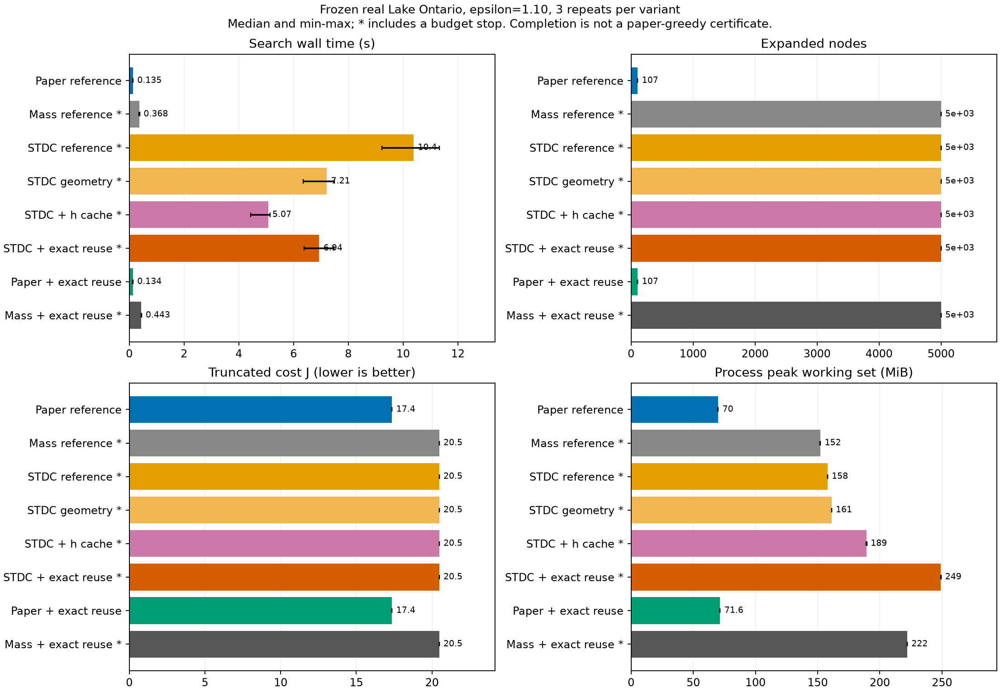

# STDC-A^SAR v0.2 研究分支

本分支基于冻结的 baseline-v1.1 复现开展 STDC 研究。**当前结论：工程缓存降低了旧 STDC 的计算耗时，但同预算下 J/Pd 没有提升，尚未证明 STDC 优于 baseline A^SAR。** 下表中的 baseline 指原 `paper_greedy` 搜索。

## 本轮核心指标

数据为本地 SHA-256 校验通过的真实历史 Lake Ontario 粒子归档：17×17 网格、500 粒子、T=49、q=0.78、seed=41。所有方法共用初始 PT、评分器及 `5000 expansions / 20000 OPEN / 30 s` 预算。t=0 不探测，J 越小越好、Pd 越大越好。

ε=1.10，每种方法三次独立进程运行；时间和内存取中位数：

| 方法 | J↓ | Pd↑ | 耗时（秒） | 进程峰值（MiB） | 扩展数 | 搜索结果 |
|---|---:|---:|---:|---:|---:|---|
| baseline：paper_greedy | **17.359684** | **0.897769** | **0.1353** | 70.02 | 107 | completed |
| 原 STDC | 20.477608 | 0.881063 | 10.3829 | 157.95 | 5000 | max_expansions，返回初始 PT |
| STDC：几何缓存 + h 缓存 | 20.477608 | 0.881063 | 5.0720 | 189.25 | 5000 | max_expansions，返回初始 PT |
| STDC：再启用严格状态支配 | 20.477608 | 0.881063 | 6.9368 | 249.08 | 5000 | max_expansions，返回初始 PT |

- 缓存版相对**原 STDC**的耗时中位数降低约 51%；这不是相对 paper baseline 的优势，也不是路径质量改进。
- ε=1.04：baseline J=17.293894、Pd=0.897370；STDC 缓存版仍为 J=20.477608、Pd=0.881063。
- ε=1.00：两者均返回初始 PT，J/Pd 相同；缓存版耗时中位数为 4.2079 秒，baseline 为 5.3199 秒。该单场景计时事实不足以证明整体优势。
- 三次重复用于观察计时波动，不是三个独立场景。进程峰值包含输入校验、预处理和路径回放。

**所有预算中止均为 uncertified；paper_greedy 即使完成也不能认证动态 ε 界。本轮 72 次真实对照没有任何认证结果。** 真实历史环境沿用本地场景假设和 PT，不声称复现原作者私有 forcing 或手工 PT。



## 改进内容与适用范围

- 缓存与 belief 无关的可达集合、探测参数和粒子因子，保持原下界数值及运算顺序。
- 增加完整状态 h 的有界 LRU 缓存。键包含深度、位置及完整 belief，不能只按 `(depth,vertex)` 复用。
- 增加可选严格状态支配：相同完整状态保留更小累计 g，支持重新入队并跳过过期堆项。
- 保留原搜索行为作为对照。几何加速自动生效；h 缓存和状态支配默认关闭，可分别启用。本场景的工程选择是 `heuristic_cache_size=4096, exact_dominance=False`。

本轮没有增强下界公式。下界偏松、预算内未生成完整路径的问题仍未解决。没有修改冻结 baseline 分支、B7 原始数据、评价器、原仿真程序、规划目标或环境 forcing；没有重新运行 Leeway。

## 验证与记录

- 新增及相关回归：93 项通过；全量：356 项通过，无失败、错误或跳过。
- 160 个随机 toy 场景、18,024 个路径前缀：无超过 1e-10 的可采纳性违规。
- 35 组小图、1,120 次搜索：通过独立 DFS Oracle 与路径回放检查。
- 两组真实 smoke 通过输入/路径检查；完整对照为 8 variants × 3 ε × 3 次重复，共 72 次：12 次 completed、60 次 max_expansions、0 次认证。
- 首轮因 pytest 临时父目录缺失而停止，原 [blocked 记录](asar_repro/outputs/stdc_v0_2/repair_20261123/validation_summary.json) 保留。修复启动目录后，r2 从新测试重新执行全部验证，未跳过该用例。

| 入口 | 内容 |
|---|---|
| [完整修复报告](asar_repro/outputs/stdc_v0_2/repair_20261123_r2/report/repair_report.md) | 全部 ε、八组消融、状态、来源、内存与局限 |
| [72 次运行 CSV](asar_repro/outputs/stdc_v0_2/repair_20261123_r2/report/metrics.csv) | J/Pd、耗时、扩展、预算状态、来源和粒子指纹 |
| [汇总 JSON](asar_repro/outputs/stdc_v0_2/repair_20261123_r2/report/aggregate.json) | 三次重复的统计及配对差值 |
| [路径与剩余质量图](asar_repro/outputs/stdc_v0_2/repair_20261123_r2/report/repair_paths_survival.png) | 同一评分器独立回放 |
| [问题归因报告](asar_repro/outputs/stdc_v0_2/diagnosis_20261123/diagnosis_report.md) | 逐节点追踪、下界分解与计算开销 |
| [修复设计与 API](asar_repro/docs/stdc_v0_2/repair_design.md) | 状态充分性、缓存边界、调用方式 |
| [代码文件清单](asar_repro/outputs/stdc_v0_2/repair_20261123_r2/code_files.json) | 本轮源代码及 SHA-256 |
| [执行记录](asar_repro/outputs/stdc_v0_2/repair_20261123_r2/execution_records.json) | 命令、seed、测试总数、重试来源 |
| [归档指纹](asar_repro/outputs/stdc_v0_2/repair_20261123_r2/sha256_manifest.json) | 报告、日志、JSON、CSV、图片校验 |
| [冻结文件保护核验](asar_repro/outputs/stdc_v0_2/repair_20261123_r2/final_preservation.json) | baseline 654 个文件与研究目录 1106 个旧文件保持不变 |

## 离线复跑

原机器可在仓库根目录运行以下入口。脚本使用现有 maritime-sar 环境，自动创建新的结果目录，按顺序执行验证，失败即停止。

```powershell
powershell -File .\asar_repro\outputs\stdc_v0_2\repair_20261123_r2\replay.ps1
```

其他机器需调整解释器、临时目录和本地冻结 baseline 路径，并准备指纹一致的原始 forcing 和粒子归档。GitHub 上的代码、指标与清单不代表所有被忽略的原始风流文件均已上传；真实运行仍必须通过 SHA 门槛，禁止以合成粒子替代。

原阶段 0–8 的说明保留在 [asar_repro/README.md](asar_repro/README.md)。
