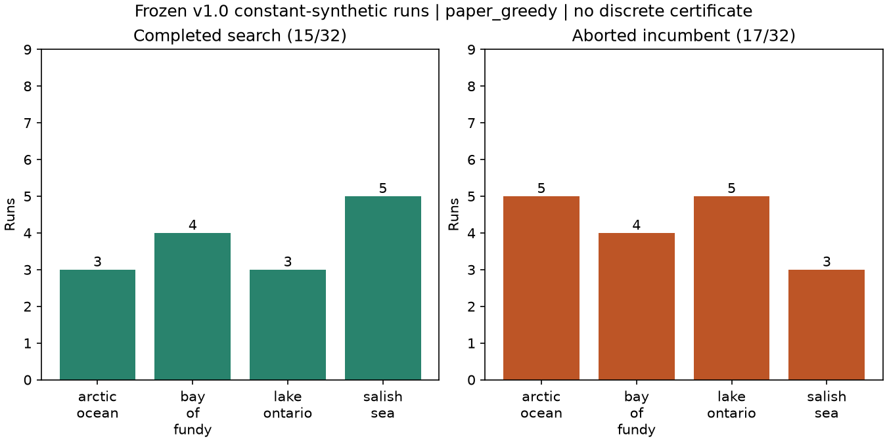

# B4 搜索结果语义核验

状态：passed。只执行小规模 Oracle 对照与旧结果重放。

本次 toy 记录 72 条；历史 32 条：正常完成 15，中止 17（均 max_expansions）。
17 条中止路线的来源均为 ParallelTrack，J 属于本地 PT，不能写成搜索改进。
历史全部使用 constant_synthetic；本次没有新增真实历史 forcing 的规划成绩。

| toy | heuristic | profile | ε | J | J−Oracle | status | source | certified |
|---|---|---|---:|---:|---:|---|---|---|
| static | zero | reference | 1.0 | 1.7380000000000002 | 0.0 | completed | search | True |
| static | zero | pruned | 1.0 | 1.7380000000000002 | 0.0 | completed | search | True |
| static | zero | stopped_PT | 1.0 | 1.8940000000000001 | 0.15599999999999992 | budget_exceeded | ParallelTrack | False |
| static | zero | stopped_no_path | 1.0 | None | None | budget_exceeded | None | False |
| static | zero | reference | 1.1 | 1.7380000000000002 | 0.0 | completed | search | True |
| static | zero | pruned | 1.1 | 1.7380000000000002 | 0.0 | completed | search | True |
| static | zero | stopped_PT | 1.1 | 1.8940000000000001 | 0.15599999999999992 | budget_exceeded | ParallelTrack | False |
| static | zero | stopped_no_path | 1.1 | None | None | budget_exceeded | None | False |
| static | mass_lb | reference | 1.0 | 1.7380000000000002 | 0.0 | completed | search | True |
| static | mass_lb | pruned | 1.0 | 1.7380000000000002 | 0.0 | completed | search | True |
| static | mass_lb | stopped_PT | 1.0 | 1.8940000000000001 | 0.15599999999999992 | budget_exceeded | ParallelTrack | False |
| static | mass_lb | stopped_no_path | 1.0 | None | None | budget_exceeded | None | False |
| static | mass_lb | reference | 1.1 | 1.7380000000000002 | 0.0 | completed | search | True |
| static | mass_lb | pruned | 1.1 | 1.7380000000000002 | 0.0 | completed | search | True |
| static | mass_lb | stopped_PT | 1.1 | 1.8940000000000001 | 0.15599999999999992 | budget_exceeded | ParallelTrack | False |
| static | mass_lb | stopped_no_path | 1.1 | None | None | budget_exceeded | None | False |
| static | paper_greedy | reference | 1.0 | 1.7380000000000002 | 0.0 | completed | search | False |
| static | paper_greedy | pruned | 1.0 | 1.7380000000000002 | 0.0 | completed | search | False |
| static | paper_greedy | stopped_PT | 1.0 | 1.8940000000000001 | 0.15599999999999992 | budget_exceeded | ParallelTrack | False |
| static | paper_greedy | stopped_no_path | 1.0 | None | None | budget_exceeded | None | False |
| static | paper_greedy | reference | 1.1 | 1.7380000000000002 | 0.0 | completed | search | False |
| static | paper_greedy | pruned | 1.1 | 1.7380000000000002 | 0.0 | completed | search | False |
| static | paper_greedy | stopped_PT | 1.1 | 1.8940000000000001 | 0.15599999999999992 | budget_exceeded | ParallelTrack | False |
| static | paper_greedy | stopped_no_path | 1.1 | None | None | budget_exceeded | None | False |
| dynamic_suboptimal | zero | reference | 1.0 | 2.185746589095029 | 0.0 | completed | search | True |
| dynamic_suboptimal | zero | pruned | 1.0 | 2.185746589095029 | 0.0 | completed | search | True |
| dynamic_suboptimal | zero | stopped_PT | 1.0 | 2.5769237177592696 | 0.3911771286642405 | budget_exceeded | ParallelTrack | False |
| dynamic_suboptimal | zero | stopped_no_path | 1.0 | None | None | budget_exceeded | None | False |
| dynamic_suboptimal | zero | reference | 1.1 | 2.185746589095029 | 0.0 | completed | search | True |
| dynamic_suboptimal | zero | pruned | 1.1 | 2.185746589095029 | 0.0 | completed | search | True |
| dynamic_suboptimal | zero | stopped_PT | 1.1 | 2.5769237177592696 | 0.3911771286642405 | budget_exceeded | ParallelTrack | False |
| dynamic_suboptimal | zero | stopped_no_path | 1.1 | None | None | budget_exceeded | None | False |
| dynamic_suboptimal | mass_lb | reference | 1.0 | 2.185746589095029 | 0.0 | completed | search | True |
| dynamic_suboptimal | mass_lb | pruned | 1.0 | 2.185746589095029 | 0.0 | completed | search | True |
| dynamic_suboptimal | mass_lb | stopped_PT | 1.0 | 2.5769237177592696 | 0.3911771286642405 | budget_exceeded | ParallelTrack | False |
| dynamic_suboptimal | mass_lb | stopped_no_path | 1.0 | None | None | budget_exceeded | None | False |
| dynamic_suboptimal | mass_lb | reference | 1.1 | 2.185746589095029 | 0.0 | completed | search | True |
| dynamic_suboptimal | mass_lb | pruned | 1.1 | 2.185746589095029 | 0.0 | completed | search | True |
| dynamic_suboptimal | mass_lb | stopped_PT | 1.1 | 2.5769237177592696 | 0.3911771286642405 | budget_exceeded | ParallelTrack | False |
| dynamic_suboptimal | mass_lb | stopped_no_path | 1.1 | None | None | budget_exceeded | None | False |
| dynamic_suboptimal | paper_greedy | reference | 1.0 | 2.197771238744739 | 0.01202464964970984 | completed | search | False |
| dynamic_suboptimal | paper_greedy | pruned | 1.0 | 2.197771238744739 | 0.01202464964970984 | completed | search | False |
| dynamic_suboptimal | paper_greedy | stopped_PT | 1.0 | 2.5769237177592696 | 0.3911771286642405 | budget_exceeded | ParallelTrack | False |
| dynamic_suboptimal | paper_greedy | stopped_no_path | 1.0 | None | None | budget_exceeded | None | False |
| dynamic_suboptimal | paper_greedy | reference | 1.1 | 2.197771238744739 | 0.01202464964970984 | completed | search | False |
| dynamic_suboptimal | paper_greedy | pruned | 1.1 | 2.197771238744739 | 0.01202464964970984 | completed | search | False |
| dynamic_suboptimal | paper_greedy | stopped_PT | 1.1 | 2.5769237177592696 | 0.3911771286642405 | budget_exceeded | ParallelTrack | False |
| dynamic_suboptimal | paper_greedy | stopped_no_path | 1.1 | None | None | budget_exceeded | None | False |
| appendix_b | zero | reference | 1.0 | 2.541733337874664 | 0.0 | completed | search | True |
| appendix_b | zero | pruned | 1.0 | 2.541733337874664 | 0.0 | completed | search | True |
| appendix_b | zero | stopped_PT | 1.0 | 3.635305940754917 | 1.0935726028802528 | budget_exceeded | ParallelTrack | False |
| appendix_b | zero | stopped_no_path | 1.0 | None | None | budget_exceeded | None | False |
| appendix_b | zero | reference | 1.1 | 2.541733337874664 | 0.0 | completed | search | True |
| appendix_b | zero | pruned | 1.1 | 2.541733337874664 | 0.0 | completed | search | True |
| appendix_b | zero | stopped_PT | 1.1 | 3.635305940754917 | 1.0935726028802528 | budget_exceeded | ParallelTrack | False |
| appendix_b | zero | stopped_no_path | 1.1 | None | None | budget_exceeded | None | False |
| appendix_b | mass_lb | reference | 1.0 | 2.541733337874664 | 0.0 | completed | search | True |
| appendix_b | mass_lb | pruned | 1.0 | 2.541733337874664 | 0.0 | completed | search | True |
| appendix_b | mass_lb | stopped_PT | 1.0 | 3.635305940754917 | 1.0935726028802528 | budget_exceeded | ParallelTrack | False |
| appendix_b | mass_lb | stopped_no_path | 1.0 | None | None | budget_exceeded | None | False |
| appendix_b | mass_lb | reference | 1.1 | 2.541733337874664 | 0.0 | completed | search | True |
| appendix_b | mass_lb | pruned | 1.1 | 2.541733337874664 | 0.0 | completed | search | True |
| appendix_b | mass_lb | stopped_PT | 1.1 | 3.635305940754917 | 1.0935726028802528 | budget_exceeded | ParallelTrack | False |
| appendix_b | mass_lb | stopped_no_path | 1.1 | None | None | budget_exceeded | None | False |
| appendix_b | paper_greedy | reference | 1.0 | 2.541733337874664 | 0.0 | completed | search | False |
| appendix_b | paper_greedy | pruned | 1.0 | 2.541733337874664 | 0.0 | completed | search | False |
| appendix_b | paper_greedy | stopped_PT | 1.0 | 3.635305940754917 | 1.0935726028802528 | budget_exceeded | ParallelTrack | False |
| appendix_b | paper_greedy | stopped_no_path | 1.0 | None | None | budget_exceeded | None | False |
| appendix_b | paper_greedy | reference | 1.1 | 2.541733337874664 | 0.0 | completed | search | False |
| appendix_b | paper_greedy | pruned | 1.1 | 2.541733337874664 | 0.0 | completed | search | False |
| appendix_b | paper_greedy | stopped_PT | 1.1 | 3.635305940754917 | 1.0935726028802528 | budget_exceeded | ParallelTrack | False |
| appendix_b | paper_greedy | stopped_no_path | 1.1 | None | None | budget_exceeded | None | False |

## 适用边界

3×3、T=4、q=.78 反例：paper_greedy 根启发值 2.617080177088715，Oracle 2.541733337874664。
另一个动态 toy 的 ε=1 次优路径在 toy_metrics.csv 中保留。以上是当前离散约定下的证据，不能外推为原论文在所有海洋场景无效。
zero/mass_lb 只有在离散模型前提成立且完成搜索时获得条件性 ε 界。浮点测试不是对所有实例的形式证明。
paper_greedy 无论完成或与 Oracle 偶然一致，均不标记离散认证。

本地 J_over_PT 的分母为本地动态 ParallelTrack，不能标成 % of optimum。
legacy_metrics.csv 把原论文 C++ / M1 Pro 时间单列为 paper_cpp_m1pro_s；本地 Python/Windows 的 planner_wall_s 与 warm_start_s 分列。没有跨机器加速比。
规划时间不含数据、OpenDrift、评分重放、Oracle 与作图；总计时间为 warm_start_s + planner_wall_s。旧环境未逐次记录的字段为未知，不用当前版本补造。
真实环境阶段将使用论文任务参数的真实历史环境重建；原作者模式循环、地图、粒子与人工 PT 尚未逐点复现。

源文件指纹、环境、输入配置及完整结果见 audit.json、toy_runs.json、legacy_runs.json。
下一阶段 B5：冻结输入上的有限预算扫描与 profile，本轮未实施。
