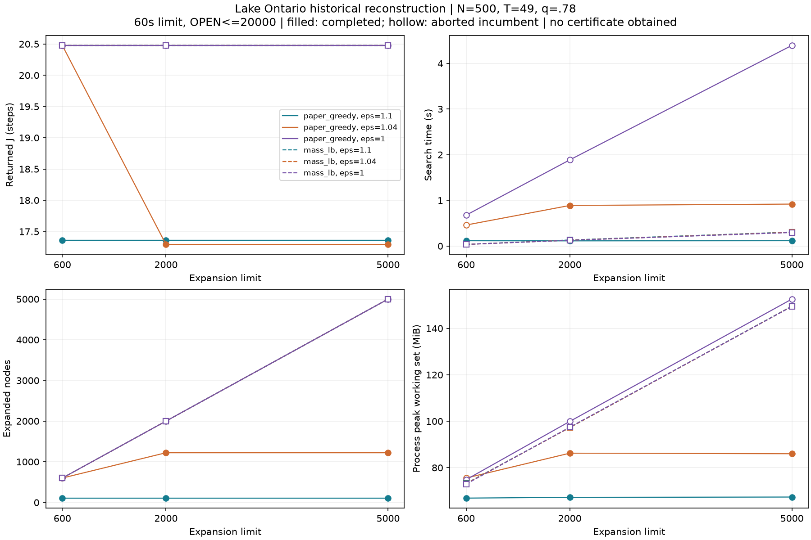

# B5 预算与性能核验

状态：passed。只执行 B5；未实施 B6 的最终基线比较。

主扫描 36 次；原 OPEN=2400 探针 2 次；独立 profile/内存及原速对照 6 次。
主扫描退出分布：{'completed': 10, 'max_expansions': 26}；OPEN 探针：{'max_open': 2}。
所有运行使用 B3 冻结的 500 条轨迹、seed=41、T=49、q=.78 和同一动态 PT 初始路线。
实际标签 historical_real_forcing_allwater：事后历史环境重建，全水域岸线假设，不是原作者完整数据复现。
主扫描设 OPEN=20000，使 5000 次展开的测试不先被 2400 OPEN 限制。30/60 秒两档按完整矩阵执行。

## 联合结果

| heuristic | ε | 展开上限 | 秒上限 | OPEN上限 | J | Pd(T) | 展开 | OPEN峰值 | 搜索秒 | 进程峰值MiB | 状态/原因 | 来源 |
|---|---:|---:|---:|---:|---:|---:|---:|---:|---:|---:|---|---|
| paper_greedy | 1.1 | 600 | 30 | 20000 | 17.3596840221 | 0.89776904 | 107 | 318 | 0.1140 | 67.25 | completed | search |
| paper_greedy | 1.1 | 600 | 60 | 20000 | 17.3596840221 | 0.89776904 | 107 | 318 | 0.1160 | 66.91 | completed | search |
| paper_greedy | 1.1 | 2000 | 30 | 20000 | 17.3596840221 | 0.89776904 | 107 | 318 | 0.1129 | 67.24 | completed | search |
| paper_greedy | 1.1 | 2000 | 60 | 20000 | 17.3596840221 | 0.89776904 | 107 | 318 | 0.1132 | 67.23 | completed | search |
| paper_greedy | 1.1 | 5000 | 30 | 20000 | 17.3596840221 | 0.89776904 | 107 | 318 | 0.1177 | 67.11 | completed | search |
| paper_greedy | 1.1 | 5000 | 60 | 20000 | 17.3596840221 | 0.89776904 | 107 | 318 | 0.1164 | 67.36 | completed | search |
| paper_greedy | 1.04 | 600 | 30 | 20000 | 20.4776083360 | 0.88106304 | 600 | 1801 | 0.4491 | 75.69 | max_expansions | ParallelTrack |
| paper_greedy | 1.04 | 600 | 60 | 20000 | 20.4776083360 | 0.88106304 | 600 | 1801 | 0.4598 | 75.55 | max_expansions | ParallelTrack |
| paper_greedy | 1.04 | 2000 | 30 | 20000 | 17.2938941546 | 0.89737042 | 1222 | 3664 | 0.8984 | 86.20 | completed | search |
| paper_greedy | 1.04 | 2000 | 60 | 20000 | 17.2938941546 | 0.89737042 | 1222 | 3664 | 0.8883 | 86.25 | completed | search |
| paper_greedy | 1.04 | 5000 | 30 | 20000 | 17.2938941546 | 0.89737042 | 1222 | 3664 | 0.9116 | 86.39 | completed | search |
| paper_greedy | 1.04 | 5000 | 60 | 20000 | 17.2938941546 | 0.89737042 | 1222 | 3664 | 0.9185 | 86.01 | completed | search |
| paper_greedy | 1 | 600 | 30 | 20000 | 20.4776083360 | 0.88106304 | 600 | 1801 | 0.6623 | 74.64 | max_expansions | ParallelTrack |
| paper_greedy | 1 | 600 | 60 | 20000 | 20.4776083360 | 0.88106304 | 600 | 1801 | 0.6762 | 74.84 | max_expansions | ParallelTrack |
| paper_greedy | 1 | 2000 | 30 | 20000 | 20.4776083360 | 0.88106304 | 2000 | 6001 | 1.8828 | 99.75 | max_expansions | ParallelTrack |
| paper_greedy | 1 | 2000 | 60 | 20000 | 20.4776083360 | 0.88106304 | 2000 | 6001 | 1.8866 | 99.93 | max_expansions | ParallelTrack |
| paper_greedy | 1 | 5000 | 30 | 20000 | 20.4776083360 | 0.88106304 | 5000 | 15001 | 4.2683 | 152.66 | max_expansions | ParallelTrack |
| paper_greedy | 1 | 5000 | 60 | 20000 | 20.4776083360 | 0.88106304 | 5000 | 15001 | 4.3932 | 152.59 | max_expansions | ParallelTrack |
| mass_lb | 1.1 | 600 | 30 | 20000 | 20.4776083360 | 0.88106304 | 600 | 1801 | 0.0347 | 73.11 | max_expansions | ParallelTrack |
| mass_lb | 1.1 | 600 | 60 | 20000 | 20.4776083360 | 0.88106304 | 600 | 1801 | 0.0359 | 73.20 | max_expansions | ParallelTrack |
| mass_lb | 1.1 | 2000 | 30 | 20000 | 20.4776083360 | 0.88106304 | 2000 | 6001 | 0.1267 | 97.20 | max_expansions | ParallelTrack |
| mass_lb | 1.1 | 2000 | 60 | 20000 | 20.4776083360 | 0.88106304 | 2000 | 6001 | 0.1327 | 97.29 | max_expansions | ParallelTrack |
| mass_lb | 1.1 | 5000 | 30 | 20000 | 20.4776083360 | 0.88106304 | 5000 | 15001 | 0.2987 | 149.79 | max_expansions | ParallelTrack |
| mass_lb | 1.1 | 5000 | 60 | 20000 | 20.4776083360 | 0.88106304 | 5000 | 15001 | 0.3062 | 149.55 | max_expansions | ParallelTrack |
| mass_lb | 1.04 | 600 | 30 | 20000 | 20.4776083360 | 0.88106304 | 600 | 1801 | 0.0347 | 73.06 | max_expansions | ParallelTrack |
| mass_lb | 1.04 | 600 | 60 | 20000 | 20.4776083360 | 0.88106304 | 600 | 1801 | 0.0354 | 73.12 | max_expansions | ParallelTrack |
| mass_lb | 1.04 | 2000 | 30 | 20000 | 20.4776083360 | 0.88106304 | 2000 | 6001 | 0.1210 | 97.23 | max_expansions | ParallelTrack |
| mass_lb | 1.04 | 2000 | 60 | 20000 | 20.4776083360 | 0.88106304 | 2000 | 6001 | 0.1274 | 97.27 | max_expansions | ParallelTrack |
| mass_lb | 1.04 | 5000 | 30 | 20000 | 20.4776083360 | 0.88106304 | 5000 | 15001 | 0.2992 | 149.50 | max_expansions | ParallelTrack |
| mass_lb | 1.04 | 5000 | 60 | 20000 | 20.4776083360 | 0.88106304 | 5000 | 15001 | 0.3016 | 149.46 | max_expansions | ParallelTrack |
| mass_lb | 1 | 600 | 30 | 20000 | 20.4776083360 | 0.88106304 | 600 | 1801 | 0.0364 | 72.95 | max_expansions | ParallelTrack |
| mass_lb | 1 | 600 | 60 | 20000 | 20.4776083360 | 0.88106304 | 600 | 1801 | 0.0357 | 72.94 | max_expansions | ParallelTrack |
| mass_lb | 1 | 2000 | 30 | 20000 | 20.4776083360 | 0.88106304 | 2000 | 6001 | 0.1270 | 97.21 | max_expansions | ParallelTrack |
| mass_lb | 1 | 2000 | 60 | 20000 | 20.4776083360 | 0.88106304 | 2000 | 6001 | 0.1255 | 97.45 | max_expansions | ParallelTrack |
| mass_lb | 1 | 5000 | 30 | 20000 | 20.4776083360 | 0.88106304 | 5000 | 15001 | 0.2941 | 149.44 | max_expansions | ParallelTrack |
| mass_lb | 1 | 5000 | 60 | 20000 | 20.4776083360 | 0.88106304 | 5000 | 15001 | 0.2959 | 149.43 | max_expansions | ParallelTrack |
| paper_greedy | 1 | 5000 | 60 | 2400 | 20.4776083360 | 0.88106304 | 800 | 2400 | 0.8651 | 78.39 | max_open | ParallelTrack |
| mass_lb | 1 | 5000 | 60 | 2400 | 20.4776083360 | 0.88106304 | 800 | 2400 | 0.0464 | 76.50 | max_open | ParallelTrack |

## 瓶颈与本轮决策

paper_greedy 的 cProfile 中，启发函数累计时间约占搜索 97.1%。主要成本是每个展开分支反复执行余下时域的 Algorithm 2 贪心模拟。累计时间包含子调用，不应把各项累计比例相加。
粒子按格索引和可达范围已缓存；profile 中仍出现的 bincount 是对各路径专属未探测权重的重新聚合，不能跨不同 belief 直接复用。
mass_lb 单次展开便宜，但下界较松，当前预算内未完成。大量 OPEN 节点各持有独立权重数组，父指针还保留祖先。不得按 (vertex,depth) 合并以压低内存。
本轮没有修改数值核心，也没有宣称没有其他优化空间。既有缓存已生效；在当前测量下，重复模拟及状态数是主要成本，简单绕过校验或改变累加方式需要另做等价性与收益实验。本轮交付可解释的预算限制及测量工具加固。

| 同配置原速测量 | 首次秒 | 复测秒 | 首次峰值MiB | 复测峰值MiB | 路径/J/计数完全相同 |
|---|---:|---:|---:|---:|---|
| paper_greedy ε=1, cap=2000 | 1.8870 | 1.8866 | 99.87 | 99.93 | True |
| mass_lb ε=1, cap=5000 | 0.3017 | 0.2959 | 149.23 | 149.43 | True |

数值实现未变，上表是首次/复测，不是优化加速比。cProfile 与 tracemalloc 分别单独运行，其额外开销不混入主扫描。

## 测量口径与保证边界

每个搜索为新子进程，不复用搜索缓存；OpenDrift 未导入或重新运行。所有路线通过统一评分器和独立逐 ID 布尔掩码重放。
独立重放最大 J 误差：0.0。本轮获得离散认证的运行数：0。
paper_greedy 完成仅表示本次搜索正常退出，不能由此获得 ε 最优保证。mass_lb 有条件下界不等于中止运行获得证书。返回 PT 时 J 属于 PT；J_over_PT 的分母为本地 PT。
本次 paper_greedy 的 ε=1.04 完成路线 J 比 ε=1.10 更低，但终点 Pd 略低；J 与终点 Pd 衡量不同目标，不据其中一个推定另一个更优。
planner_wall_s 仅求解；warm_start_s 是一次实际 PT 构造时间，以同一未摊销成本记入各运行；total_wall_s 为二者之和。worker_wall_s 另含启动、输入校验和报告，不能与纯求解时间混用。
peak_process_MiB 为独立进程从启动至搜索返回的 Windows 峰值工作集，包含导入与预处理，不是只计搜索新增的内存。rss_before_search_MiB 为起点工作集，不能简单相减得到精确的搜索峰值。
诊断运行的 search_allocation_peak_MiB 是 tracemalloc 在搜索区间追踪的分配峰值，不含其未追踪的原生内存。frontier_belief_lower_bound_MiB 只计 OPEN 中权重数组的最低负担，未计祖先、Node、heap、索引及临时数组。
CPU/可用 affinity、NumPy 构建、环境与单线程变量均记录于 manifest。Windows 正常调度下每个矩阵单元测一次，不做统计加速结论。
限时为协作式检查；父进程另有 max_seconds+60 秒 watchdog。任何 watchdog 或 worker 异常都显式写入 JSON，路线/得分置 null，整轮命令失败退出。本轮真实扫描没有触发时间上限或 watchdog，先触发的是展开或 OPEN 限制；30 改成 60 秒未改变本轮的路线、计数与退出状态。

## 文件与下一步

metrics.csv/scan_runs.json 保存主扫描与 OPEN 探针；diagnostic_metrics.csv/pilot_runs.json 保存诊断。
profile_cprofile.prof/.txt 与 mass_profile_cprofile.prof/.txt 保留可复查调用栈；对应 *_stats.json 为结构化热点。
pilot_manifest.json、scan_manifest.json、warm_start.json 保存配置、代码、输入和 CPU 条件；summary.json 汇总状态。
下一阶段 B6 才进行相同真实输入上 PT / ASAR_paper / ASAR_mass_lb / 可选 ACO_inspired 的最终比较。
