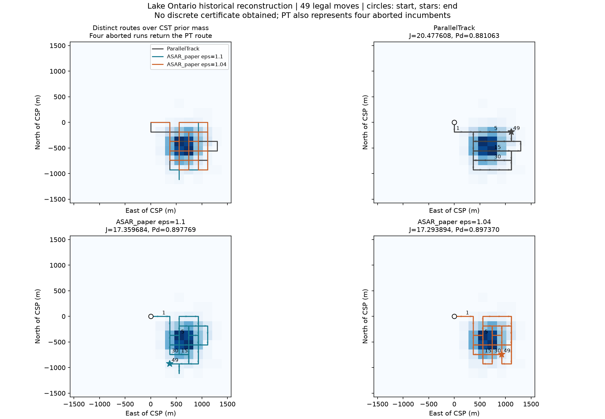
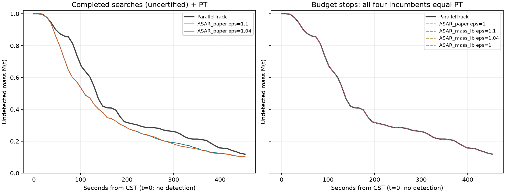
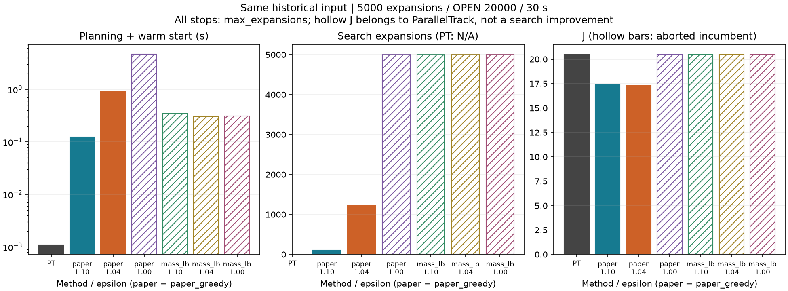
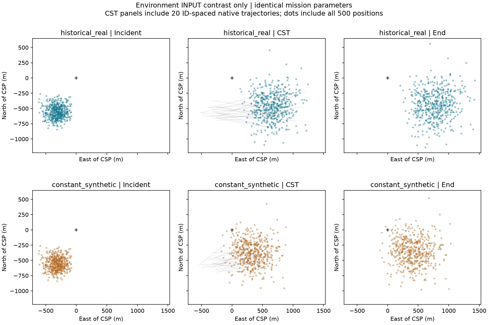
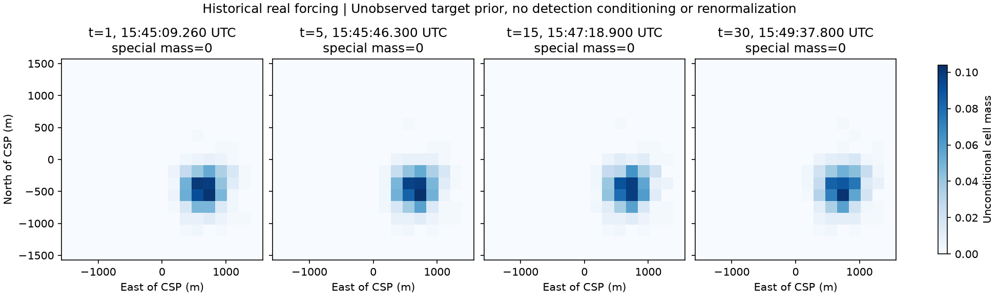

# B6 · Lake Ontario 同数据基线对照

状态：passed。范围为 B6，未进入后续阶段。

B3 冻结的同一 500 粒子归档，T=49、q=.78、seed=41、17×17 格、格宽 185.2 m、步长 9.26 s。
事故 2025-08-26 14:45 UTC；CST 15:45 UTC；搜索终点 15:52:33.740 UTC。起点为 CSP 格 144，第 0 帧不探测。
环境标签 historical_real_forcing_allwater：HRRR f00 + LOOFS 18 UTC nowcast 的事后重建，采用全水域岸线策略，并保留特殊格质量。

## 相同真实输入的结果

| 方法 | ε | J | Pd(T) | M(T) | 搜索/构造秒 | PT初始解秒 | 展开 | 状态/原因 | incumbent | 离散认证 |
|---|---:|---:|---:|---:|---:|---:|---:|---|---|---|
| ParallelTrack | None | 20.4776083360 | 0.88106304 | 0.11893696 | 0.001095 | 0.000000 | None | completed | ParallelTrack | False |
| ASAR_paper | 1.1 | 17.3596840221 | 0.89776904 | 0.10223096 | 0.122203 | 0.001095 | 107 | completed | search | False |
| ASAR_paper | 1.04 | 17.2938941546 | 0.89737042 | 0.10262958 | 0.917765 | 0.001095 | 1222 | completed | search | False |
| ASAR_paper | 1.0 | 20.4776083360 | 0.88106304 | 0.11893696 | 4.704898 | 0.001095 | 5000 | max_expansions | ParallelTrack | False |
| ASAR_mass_lb | 1.1 | 20.4776083360 | 0.88106304 | 0.11893696 | 0.342867 | 0.001095 | 5000 | max_expansions | ParallelTrack | False |
| ASAR_mass_lb | 1.04 | 20.4776083360 | 0.88106304 | 0.11893696 | 0.307084 | 0.001095 | 5000 | max_expansions | ParallelTrack | False |
| ASAR_mass_lb | 1.0 | 20.4776083360 | 0.88106304 | 0.11893696 | 0.308137 | 0.001095 | 5000 | max_expansions | ParallelTrack | False |

PT 为正常构造的基线，不计入搜索完成率。6 次搜索中 2 次完成、4 次展开限额中止；中止路线全部来自 PT。
paper_greedy 的两条完成路线均未认证；mass_lb 虽有模型内条件下界，本轮均未完成，因此未获得证书。
J 是 t=1..T 的剩余质量累积，越小越好；Pd(T) 越大越好。ε=1.04 的 J 更小而终点 Pd 略低，不能把两指标混同。
每条路径重新调用统一 score_path 检查起点、T 步四邻接合法性与 J/Pd/M，并用独立 ID 布尔掩码再次重放；逐步质量包含 land/outside/inactive/unknown，未重归一化。
所有实际中止为 max_expansions；没有真实时间超限或 watchdog 中止。完整停止状态仍逐条保存。
PT 不具有搜索扩展计数，因此 expanded/generated/pruned/peak_open 为 null；正常构造 PT 不表示其最优。
时间由本机 Python/Windows 新子进程测量，planner_wall_s 包含求解器内部初始解评分；warm_start_s 单列 PT 构造成本。total_wall_s 为二者之和，不含归档校验、运动对象构造、独立重放或作图。

## real / synthetic 环境输入对照

本轮算法表只含 historical_real。旧 Stage 7 的 constant_synthetic 仅作输入对照，没有混入算法排名或修改旧结果。两个归档的任务参数、seed、N、UTC 与网格相同。
旧常量风为 (4,0) m/s，流为 (0.15,0.05) m/s。下面历史统计来自 B2 的 LKP/CSP 两位置、四时刻抽样，不代表全湖或粒子加权平均。

| 历史场 | 分量最小值 m/s | 分量均值 m/s | 分量最大值 m/s | 速率范围 m/s |
|---|---|---|---|---|
| wind | [4.933811664581299, 1.3312333822250366] | [5.168316125869751, 1.89818973839283] | [5.492729663848877, 2.414381504058838] | [5.447945359871931, 5.651748532806082] |
| current | [0.1997048556804657, 0.011498522013425827] | [0.2288019973784685, 0.012622470851056278] | [0.2556801736354828, 0.013007544912397861] | [0.20010310511397447, 0.25601001545706215] |

environment_comparison.json 保存两个输入在 CST/终点的质心、距离分位数与有效定位质量；environment_mass.csv 保存全部 50 帧的特殊格质量。本次两输入四类特殊格均为 0，该事实不取消特殊格保留机制。

## 可验证事实与复现边界

该实验是使用论文任务参数的真实历史环境重建。原作者精确模式运行 cycle、原始粒子、地图、手工 ParallelTrack 及真实完整实验未逐点复现。
论文的 ε 保证、本地实现和本轮数值事实分别记录。本轮无任何 ε 最优证书；原动态 toy 反例继续保留，未用完成搜索替代可采纳性证明。
J_over_PT 仅按本地动态 PT 归一化，不称为 percent of optimum；本轮未修改或重填原 Table II C++ / M1 Pro 秒数，也未将本地时间当作跨机器速度对照。
可选 ACO_inspired 本轮未执行；没有 ACO_original 声明。

## 产物与复跑

run_manifest.json 保存原始风流 SHA、粒子/配置/代码指纹、机器与命令。metrics.csv/runs.json 保存结果，step_metrics.csv 保存 350 行逐步 UTC/访问格/质量/累积 J。
b6_workers/ 保留每次搜索的请求参数和原始输出。输出目录存在 B6 结果时拒绝覆盖，复跑须指定新的 --output-dir。
本轮已停止；后续阶段、其他场景导入及工程集成均未执行。
