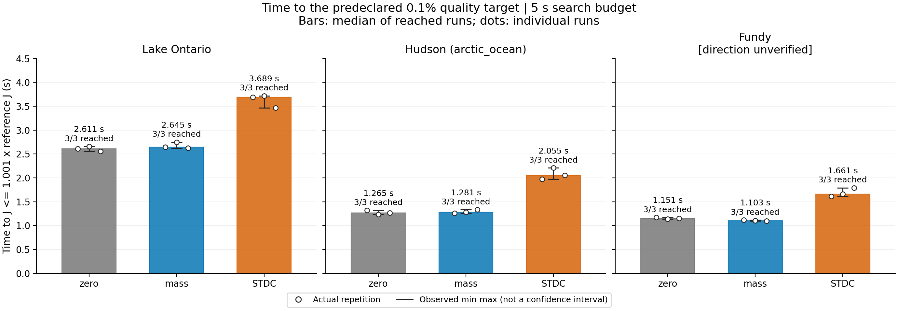

# STDC 最后一批评估报告

**STDC 未达到预注册的质量或时间收益门槛；建议暂停以 STDC 为中心的性能微调，保留其下界和审计价值。**

本报告从最终 [summary.json](summary.json)、冻结 [protocol.json](protocol.json) 与 runs 内原始结果生成。批次 `stdc-final-assessment-20261125`，基线 `6167d344bd36`；正式目录 `stdc_final_assessment_20261125_r1`。数值按记录显示，不把接近门槛视为通过。当前研究问题是：更强的 STDC 下界能否在相同搜索框架内，抵消自身计算代价并产生可重复的原目标收益，以及少量早期事件和共享路径约束是否值得继续研究。

## 1. 冻结问题、对照和继续投入门槛

| 场景 | 网格 | T | 粒子 | 共同 PT J | 历史参考 J | 解释范围 |
| --- | --- | --- | --- | --- | --- | --- |
| Lake Ontario | 17×17 | 49 | 500 | 20.477608 | 17.264874 | 主要场景 |
| Hudson（arctic_ocean） | 65×85 | 60 | 500 | 25.293461 | 20.386109 | 主要场景 |
| Fundy† | 49×61 | 55 | 500 | 53.067098 | 45.881082 | 附条件 |

目标始终是探测后未发现质量之和 $J=\sum_{t=1}^{T}M_t$，越小越好；Pd 是同一路径的另一项结果。四邻接、无等待、t=0 不探测、粒子列身份和绝对时刻不变，前缀后质量不归一化，特殊 bins 保留质量。† Fundy 的物理方向问题仍未解决，只作为带标签的算法回放；主要决策基于 Lake Ontario 与 Hudson 档案。本批继承档案来源记录，没有重新审计原始 forcing；固定的500粒子重复运行不是独立验证集。

**质量门槛：**5s 下，STDC 相对 zero/mass 中较好的 J 中位数，在至少一个主要场景改善 ≥0.5%，另一场景相对退化不得超过 $10^{-8}$，且重复完整。**时间门槛：**到历史参考 J×1.001 的实际 time-to-target，在两个主要场景均比每一个廉价对照降低 ≥20%；所有重复必须达到目标，且最终质量不退化。二者任一通过才进入新档案验证。pair 根节点只关闭原 U−L 区间 ≥10% 时才触发有限接入探索；局部前缀不能替代根节点。

## 2. 相同框架和墙钟预算的结果

### 5s 主比较

| 场景 | 下界 | 有效/计划 | J 中位数 [最小, 最大] | Pd 中位数 | bound 占时 | expanded | pruned |
| --- | --- | --- | --- | --- | --- | --- | --- |
| Lake Ontario | zero | 3/3 | 17.2649 [17.2649, 17.2649] | 0.897364 | 1.30% | 39899 | 0 |
| Lake Ontario | mass | 3/3 | 17.2649 [17.2649, 17.2649] | 0.897364 | 7.49% | 34465 | 0 |
| Lake Ontario | STDC | 3/3 | 17.2649 [17.2649, 17.2649] | 0.897364 | 24.72% | 5855 | 488 |
| Hudson（arctic_ocean） | zero | 3/3 | 20.3861 [20.3861, 20.3861] | 0.908583 | 0.99% | 28936 | 0 |
| Hudson（arctic_ocean） | mass | 3/3 | 20.3861 [20.3861, 20.3861] | 0.908583 | 5.36% | 23515 | 0 |
| Hudson（arctic_ocean） | STDC | 3/3 | 20.3861 [20.3861, 20.3861] | 0.908583 | 34.25% | 4137 | 855 |
| Fundy† | zero | 3/3 | 45.8923 [45.8923, 45.8923] | 0.413774 | 1.99% | 65930 | 0 |
| Fundy† | mass | 3/3 | 45.8923 [45.8923, 45.8923] | 0.413774 | 11.52% | 57677 | 0 |
| Fundy† | STDC | 3/3 | 45.8811 [45.8811, 45.8811] | 0.415865 | 35.82% | 4264 | 2760 |

### 1s 辅助比较

| 场景 | 下界 | 有效/计划 | J 中位数 [最小, 最大] | Pd 中位数 | 0.1%目标：达到数; 已达中位秒; 删失 |
| --- | --- | --- | --- | --- | --- |
| Lake Ontario | zero | 3/3 | 20.4776 [20.4776, 20.4776] | 0.881063 | 0/3; —; 删失3 |
| Lake Ontario | mass | 3/3 | 20.4776 [17.2939, 20.4776] | 0.881063 | 0/3; —; 删失3 |
| Lake Ontario | STDC | 3/3 | 20.4776 [20.4776, 20.4776] | 0.881063 | 0/3; —; 删失3 |
| Hudson（arctic_ocean） | zero | 3/3 | 25.2935 [25.2935, 25.2935] | 0.817637 | 0/3; —; 删失3 |
| Hudson（arctic_ocean） | mass | 3/3 | 25.2935 [25.2935, 25.2935] | 0.817637 | 0/3; —; 删失3 |
| Hudson（arctic_ocean） | STDC | 3/3 | 25.2935 [25.2935, 25.2935] | 0.817637 | 0/3; —; 删失3 |
| Fundy† | zero | 3/3 | 53.0671 [53.0671, 53.0671] | 0.102055 | 0/3; —; 删失3 |
| Fundy† | mass | 3/3 | 53.0671 [53.0671, 53.0671] | 0.102055 | 0/3; —; 删失3 |
| Fundy† | STDC | 3/3 | 53.0671 [53.0671, 53.0671] | 0.102055 | 0/3; —; 删失3 |

每个场景/方法/预算 3 次，顺序轮换，统一 PT 起点和 guide 设置；只改变下界。表内 J 已排除截止时间后才完成的改善，原返回值和超时 history 仍保留。计时包含任务内部准备、guide、bound 与搜索，进程启动、输入读取和环境核验另存 worker_wall_s。范围是观测最小—最大，不是置信区间；仅三次重复不能支持宽泛统计外推。

| 主要场景 | STDC质量相对收益 | 时间比 STDC/zero | 时间比 STDC/mass | 全部达标 | 时间门槛 |
| --- | --- | --- | --- | --- | --- |
| Lake Ontario | 0.0000% | 1.4130 | 1.3946 | 是 | 未通过 |
| Hudson（arctic_ocean） | 0.0000% | 1.6243 | 1.6043 | 是 | 未通过 |

按原始记录独立复算：质量筛选 未通过，时间筛选 未通过。时间比大于1表示 STDC 更慢；单纯减少展开数不能替代同质量到达时间。这里只比较本机同批结果，旧 Windows 上的绝对时间不参与任何速度比。

### 实际到达时间与删失

| 场景 | 下界 | near_reference_0.5pct | near_reference_0.1pct | reference |
| --- | --- | --- | --- | --- |
| Lake Ontario | zero | 3/3; 0.9715; 删失0 | 3/3; 2.6106; 删失0 | 3/3; 2.6282; 删失0 |
| Lake Ontario | mass | 3/3; 0.9741; 删失0 | 3/3; 2.6452; 删失0 | 3/3; 2.6647; 删失0 |
| Lake Ontario | STDC | 3/3; 1.3663; 删失0 | 3/3; 3.6888; 删失0 | 3/3; 3.7048; 删失0 |
| Hudson（arctic_ocean） | zero | 3/3; 1.2652; 删失0 | 3/3; 1.2652; 删失0 | 3/3; 1.7101; 删失0 |
| Hudson（arctic_ocean） | mass | 3/3; 1.2810; 删失0 | 3/3; 1.2810; 删失0 | 3/3; 1.7187; 删失0 |
| Hudson（arctic_ocean） | STDC | 3/3; 2.0551; 删失0 | 3/3; 2.0551; 删失0 | 3/3; 2.6995; 删失0 |
| Fundy† | zero | 3/3; 1.1506; 删失0 | 3/3; 1.1506; 删失0 | 0/3; —; 删失3 |
| Fundy† | mass | 3/3; 1.1029; 删失0 | 3/3; 1.1029; 删失0 | 0/3; —; 删失3 |
| Fundy† | STDC | 3/3; 1.6611; 删失0 | 3/3; 1.6611; 删失0 | 3/3; 4.7350; 删失0 |

每格依次为达到数/计划数、已达到运行的中位秒、有效运行中的删失数。时间中位数仅对达到者计算，未全部达到时不能视为完整样本中位数；未达到不填成5s，也不记成0。CSV 另存真实截止/终止删失时刻；缺测与有效删失分开。更难的 reference 目标未达不等于算法失败，但不能据此声称已有速度优势。

图：5s预算下达到预声明 0.1% 质量目标的实际耗时，纵轴从0起。柱为达到者中位数，圆点为三次真实记录，须线为观测最小—最大，不是置信区间；若有未达到者，以空心上三角标明终止删失时刻，不冒充达到时间。PNG 与 [SVG](performance.svg) 同图，历史参考只是已知可行解，不是已证明最优值。

## 3. bound 计算开销和固定工作量诊断

| 场景 | 下界 | work expanded | 总秒 | bound秒 | cheap/bound剪枝 | J | 停止原因 |
| --- | --- | --- | --- | --- | --- | --- | --- |
| Lake Ontario | zero | 5000 | 2.5641 | 0.0103 | 0/0 | 17.266645 | max_expansions |
| Lake Ontario | mass | 5000 | 2.7876 | 0.0635 | 0/0 | 17.266645 | max_expansions |
| Lake Ontario | STDC | 5000 | 3.9326 | 0.9772 | 0/421 | 17.264874 | max_expansions |
| Hudson（arctic_ocean） | zero | 5000 | 2.4076 | 0.0106 | 0/0 | 20.386109 | max_expansions |
| Hudson（arctic_ocean） | mass | 5000 | 2.4487 | 0.0588 | 0/0 | 20.386109 | max_expansions |
| Hudson（arctic_ocean） | STDC | 5000 | 5.7381 | 1.9823 | 0/1269 | 20.386109 | max_expansions |
| Fundy† | zero | 5000 | 1.5500 | 0.0081 | 0/0 | 45.895278 | max_expansions |
| Fundy† | mass | 5000 | 1.6279 | 0.0551 | 0/0 | 45.895278 | max_expansions |
| Fundy† | STDC | 5000 | 5.7777 | 2.0846 | 0/3205 | 45.881082 | max_expansions |

冻结工作上限为 5000 次、保护墙钟 30s，此组每方法只有一次，只用于定位成本。若实际工作量未齐，不能称为等工作比较；即使齐，不同搜索树的工作也不必等价。主表 bound 占时是逐次 bound_wall_s/算法总时长的中位数。CSV 同时给出 guide/bound 调用、各类剪枝、generated、展开和实际 RSS；只有剪枝收益足以抵消每次下界求值成本，时间优势才成立。

## 4. 最多24条早期事件候选

| 场景 | 初始路线 | 完整 | unique | duplicates | 首次分歧步×条数 | 预算内J | 突破参考 | 秒 |
| --- | --- | --- | --- | --- | --- | --- | --- | --- |
| Hudson（arctic_ocean） | common_PT | 24 | 22 | 2 | 5×6, 6×12, 7×6 | 20.668392 | 否 | 0.035 |
| Hudson（arctic_ocean） | historical_reference | 24 | 22 | 2 | 5×6, 6×8, 7×4, 8×2, 9×4 | 20.386109 | 否 | 0.040 |
| Fundy† | common_PT | 24 | 23 | 1 | 1×12, 5×12 | 46.691721 | 否 | 0.032 |
| Fundy† | historical_reference | 24 | 23 | 1 | 1×12, 9×12 | 45.881082 | 否 | 0.033 |
| Lake Ontario | common_PT | 24 | 17 | 7 | 1×12, 4×12 | 17.517600 | 否 | 0.026 |
| Lake Ontario | historical_reference | 24 | 17 | 7 | 1×12, 3×12 | 17.264874 | 否 | 0.026 |

记录中的早期分歧候选合计 144 条，各运行 unique_new_routes 合计 124（不同初始路线的运行之间不去重）。主要场景严格突破历史参考的运行 0 个，正式 follow-up 未被触发。完整候选计数包括协作截止边界上完成的复算，正式胜出只看预算内选定 J；duplicates 不冒充新搜索方向。相对较弱 PT 的改善只说明构造有效，突破历史参考才触发后续。事件顺序是约束设计，实际探测顺序另存 archive；本批有限候选不构成所有早期结构的穷尽否定。

## 5. 共享路径 pair 下界的数学信号与成本

仅在根和三个预声明前缀做诊断。每个节点先把整段未来 cell-id 序列完全相同的列精确合并，并求当前权重之和；不按相近轨迹近似聚类。再从当前质量较大的组中按冻结规则选最多4个互斥 pair，其余质量整体使用 STDC。分组各自选路线是原问题的松弛，最终取 $\max(h_{STDC}(b),\sum_G h_G+h_{STDC}(b_{rest}))$；不能把 pair 增量直接加到 full STDC，也不能宣称混合剩余组必然支配全粒子 singleton DP。

| 场景 | depth | 组数 | 当前质量 | 选中质量/占比 | 原STDC | 组合bound | 关闭U−L | 总秒 | 状态 |
| --- | --- | --- | --- | --- | --- | --- | --- | --- | --- |
| Hudson（arctic_ocean） | 0 | 379 | 1.0000 | 0.1180 / 11.8% | 10.479531 | 10.479531 | 0.0000% | 1.158 | completed |
| Hudson（arctic_ocean） | 20 | 276 | 0.3787 | 0.0709 / 18.7% | 3.750283 | 3.750283 | 0.0000% | 0.515 | completed |
| Hudson（arctic_ocean） | 30 | 220 | 0.2471 | 0.0540 / 21.8% | 2.384119 | 2.824118 | 20.6861% | 0.355 | completed |
| Hudson（arctic_ocean） | 40 | 165 | 0.1703 | 0.0436 / 25.6% | 1.834576 | 1.852520 | 2.7272% | 0.188 | completed |
| Fundy† | 0 | 500 | 1.0000 | 0.0160 / 1.6% | 42.448240 | 42.448240 | 0.0000% | 0.519 | completed |
| Fundy† | 18 | 499 | 0.9797 | 0.0180 / 1.8% | 24.847600 | 24.847600 | 0.0000% | 0.259 | completed |
| Fundy† | 27 | 488 | 0.8679 | 0.0260 / 3.0% | 17.744560 | 17.744560 | 0.0000% | 0.161 | completed |
| Fundy† | 36 | 455 | 0.7549 | 0.0380 / 5.0% | 11.634866 | 11.634866 | 0.0000% | 0.124 | completed |
| Lake Ontario | 0 | 335 | 1.0000 | 0.1940 / 19.4% | 9.179978 | 9.855297 | 8.3529% | 0.070 | completed |
| Lake Ontario | 16 | 257 | 0.3923 | 0.0845 / 21.5% | 2.720923 | 3.033648 | 8.4049% | 0.047 | completed |
| Lake Ontario | 24 | 217 | 0.2595 | 0.0541 / 20.9% | 2.471809 | 2.471809 | 0.0000% | 0.036 | completed |
| Lake Ontario | 32 | 161 | 0.1884 | 0.0499 / 26.5% | 1.669672 | 1.737073 | 11.0379% | 0.026 | completed |

严格超过 $10^{-10}$ 的增强发生在 5/12 个节点；达到根节点 10% 筛选门槛的主要场景为 无。表内区间关闭率为 $(L_{pair}-L_{STDC})/(U-L_{STDC})$，U 是同一固定前缀的已知可行后缀原目标；仅浮点噪声的差异不计增强。前缀深处即使比例较大，也只是条件子问题的数学信号。总秒包含原 STDC、分组、选对与 DP；有限选中质量限制可能收益，未过门槛不能否定所有耦合下界。每个 ordinary/full/grouped/final bound 均独立检查 ≤该 U+1e−10，任何违例均在报告顶部标为 FATAL。

保存的 1×4 toy（起点1、粒子0/3、各0.5、H=2、q=0.78）给出：独立粒子下界 0.83、STDC 0.83、共享路径 pair 1.22，独立枚举 1.22。这是耦合路线约束能严格增强下界的存在性见证，不说明大场景每秒求解收益。来源：[pair_toy.json](validation/pair_toy.json)。

## 6. STDC 下界的数学价值及证明边界

数学价值与速度收益分开判断。可采纳下界为任一真实合法后缀提供保守代价，根节点可与独立复算的可行 U 构成 $L_0\le J^*\le U$；$U-L_0$ 给出加性次优上界，$L_0>0$ 时 $U/L_0-1$ 给出相对上界。更强的 STDC 在理论上能排除更多不可能改善的分支；实现上的求值开销是否值得，必须由上述同框架实验回答。中途截断的 OPEN、受限 MILP 的 dual、候选路线的 primal，都不能冒充全局下界证书。

独立标量 DFS 审计状态 `passed`：36 个小模型，288 个不同前缀，6756 条枚举后缀；不等式最大正违例 8.881784197001252e-16，容差 1e-10。审计检查可采纳性、非负性、STDC→stepwise→reach/capacity→mass 的支配关系和根区间，覆盖动态轨迹、q=0/1/0.78/非均匀 q、未归一化前缀质量和特殊 bins。有限枚举支持实现正确性，普遍命题仍依赖[数学推导](../../docs/stdc_final_assessment/theory.md)；pair 的向下浮点 guard 是工程保护，不是形式化区间证明。

## 7. MILP 四臂受限修复检查

| 臂 | 记录/算法/停止原因 | 有效/计划 | J中位数 [范围] | 改善次数 | 建模/求解秒 | restricted dual [范围] | restricted gap |
| --- | --- | --- | --- | --- | --- | --- | --- |
| cold | recorded/budget_exceeded/max_seconds×2 | 2/2 | 20.3861 [20.3861, 20.3861] | 0 | 0.032 / 30.055 | 19.50267 [19.50267, 19.50267] | 4.334% |
| warm_only | recorded/budget_exceeded/max_seconds×2 | 2/2 | 20.3861 [20.3861, 20.3861] | 0 | 0.038 / 30.329 | 19.50686 [19.50540, 19.50831] | 4.313% |
| cutoff_only | recorded/budget_exceeded/max_seconds×2 | 2/2 | 20.3861 [20.3861, 20.3861] | 0 | 0.034 / 30.017 | — | — |
| warm_cutoff | recorded/budget_exceeded/max_seconds×2 | 2/2 | 20.3861 [20.3861, 20.3861] | 0 | 0.032 / 30.382 | 19.52578 [19.52129, 19.53026] | 4.220% |

在 Hudson（arctic_ocean） 固定 depth=20、corridor radius=3，warm start 与 objective cutoff 构成2×2；每臂 2 次、每次 30s，presolve按冻结设置关闭。budget_exceeded 表示预算停止，不等于已证最优；blocked 单列且不伪装成零改善。dual/gap仅属于该受限子问题、还是求解器数值估计，不能与全空间 STDC 区间拼接。改善都须原目标复算；候选被接受、solver status、超时及警告原样保留在 raw JSON/日志。

warm start 请求 4 次，原生提交 4/4、读回验证 4/4；记录中 node_count=0 的运行 8/8，不能把它们解释为已经充分探索分支树。合作式30s停止的实测超额秒为 0.089 [0.027, 0.806]（中位数[范围]），已单独保存；不同的停止超额不能作为更快求解的证据。

## 8. 验证、环境阻塞与证据保存

冻结验证：pytest 日志 314 passed、23 subtests passed；JUnit 实际 tests=337、testcase元素=314、failures=0、errors=0、skipped=0。数字直接读取日志/XML，不把子测试重复加成主测试。正式环境：Linux-6.18.57-x86_64-with-glibc2.41，CPU AMD EPYC 9V74 80-Core Processor，Python 3.12.14 (main, Aug 25 2026, 14:00:49) [Clang 22.1.3 ]，NumPy 2.3.5 / SciPy 1.17.0 / HiGHS 1.8.0；数值库线程数固定1，任务使用新进程串行执行。

首轮目录保留 63 条启动记录，其中 63 条 blocked、0 份算法 raw_result；解释器路径中 `asar_repro/../.venv` 与规范化 `.venv` 被严格环境检查误判不一致，失败发生在算法计时前。修复解释器路径规范化与首错停止后，重新验证/冻结于 r1。两轮 protocol.config 比较为 完全相同；旧启动阻塞不纳入 J、Pd 或性能统计，不删除或覆盖。详见[首轮记录](../stdc_final_assessment_20261125/RUN_BLOCKED.md)。

本目录实际记录 89 条；证据审计发现 fatal 0 项、不完整 0 项。每次运行的 task、record、raw_result、stdout.log、stderr.log 均保留；脚本复核 protocol/raw/验证和冻结源码哈希。[comparison.csv](comparison.csv) 一行对应一次运行，包含原始路径、状态、删失和成本，可追溯表格。正式计时结束后生成本报告与图，不重跑算法、不改写结果；toy为追加验证证据，原有冻结验证文件不变。

[最终保全记录](final_preservation.json) 状态 `passed`：基点原有 57 个源文件逐个 git blob 比对，修改 0 个；输入粒子保持不变=True，正式 blocked=0。本报告还重新核对了三个输入及 metadata 的 SHA256。

## 9. 下一步策略

**F阶段（独立档案验证）状态：`not_triggered`。**本批未触发进入F阶段，没有实施新的独立档案实验；同一500粒子的重复计时只检查运行波动，从未记作 holdout。

执行冻结止损规则：暂停继续围绕 STDC 做细碎性能调整，保留它作为安全下界、研究基线和根区间工具。后续研究优先要求新的可观测机制：能改变早期访问结构的候选，或在更大质量上显著缩紧的共享路线约束；都先以有限成本产生严格参考改善或足够根区间缩紧，再接入搜索并检验净时间收益。本批没有达到门槛的数学信号仍应保存，但不能以接近门槛或条件前缀改善为由事后改变通过标准。
