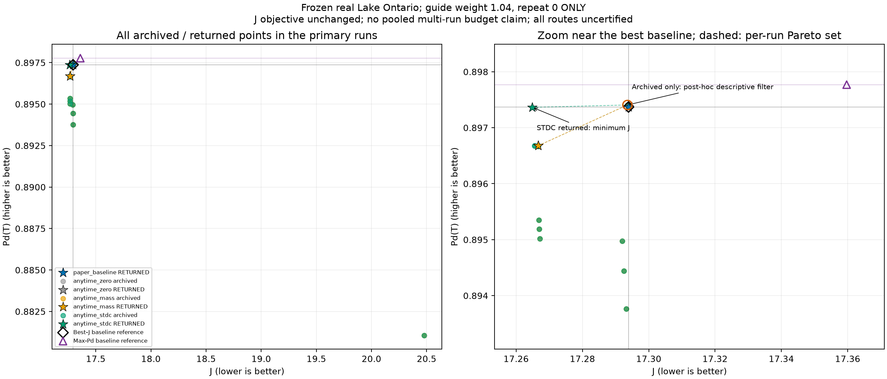

# 已接受候选的 J/Pd 取舍（事后描述性分析）

36 次基准运行已通过；对 26 条唯一归档/参考路径重新调用冻结评分器，保留 201 条带运行归属的候选记录。所有路径均合法，未修改搜索目标、返回路径或原结果。

## 主要预设：STDC、guide=1.04、repeat=0

|记录|J ↓|Pd ↑|生成时累计展开|生成时方法秒数|角色|
|---|---:|---:|---:|---:|---|
|最好 J baseline|17.29389415456|0.89737041888|—|—|参考返回路径|
|baseline 最大 Pd 设置|17.35968402208|0.89776904256|—|—|另一权重的参考返回路径|
|STDC 最终返回|17.26487444800|0.89736441600|4056|3.866782|按原始最小 J 返回|
|同次运行内的事后筛选候选|17.29356023968|0.89740619904|1510|1.525391|仅为归档候选，未返回|

最终返回相对最好 J baseline：ΔJ=-0.02901970656，ΔPd=-0.00000600288（-0.000600288 个百分点）。
原算法只最小化 J；继续降低 J 时允许 Pd 出现微小下降。这是两个指标的取舍，不能把归档候选的 Pd 冒充为最终返回指标。

该次运行确实曾生成 1 条同时满足 `J < 最好 baseline J` 且 `Pd ≥ 该 baseline Pd` 的已接受候选。
表中的候选是在这一个已完成预算记录内，事后按 Pd 门槛筛选后 J 最小的路径。这是描述性分析，未实现或验证新的受约束规划方法，也未改变正式返回策略。

进一步用 baseline 各设置中的最大 Pd 作门槛：该主要 STDC 运行内合格候选 0 条。
这个更严格门槛对应另一条 baseline 返回路径；它不是最好 J 路径的 Pd。

## 分运行核对（禁止跨预算合并结论）

|方法|guide|重复|归档记录数|J 改善且 Pd≥最好J baseline|J 改善且 Pd≥最大baseline Pd|返回是否同时改善最好J baseline|
|---|---:|---:|---:|---:|---:|---|
|paper_baseline|1.04|0|1|0|0|否|
|anytime_zero|1.04|0|11|1|0|否|
|anytime_mass|1.04|0|11|1|0|否|
|anytime_stdc|1.04|0|14|1|0|否|
|anytime_zero|1.04|1|11|1|0|否|
|anytime_mass|1.04|1|11|1|0|否|
|anytime_stdc|1.04|1|14|1|0|否|
|paper_baseline|1.04|1|1|0|0|否|
|anytime_mass|1.04|2|11|1|0|否|
|anytime_stdc|1.04|2|14|1|0|否|
|paper_baseline|1.04|2|1|0|0|否|
|anytime_zero|1.04|2|11|1|0|否|
|paper_baseline|1.1|0|1|0|0|否|
|anytime_zero|1.1|0|6|0|0|否|
|anytime_mass|1.1|0|6|0|0|否|
|anytime_stdc|1.1|0|13|0|0|否|
|anytime_zero|1.1|1|6|0|0|否|
|anytime_mass|1.1|1|6|0|0|否|
|anytime_stdc|1.1|1|13|0|0|否|
|paper_baseline|1.1|1|1|0|0|否|
|anytime_mass|1.1|2|6|0|0|否|
|anytime_stdc|1.1|2|13|0|0|否|
|paper_baseline|1.1|2|1|0|0|否|
|anytime_zero|1.1|2|6|0|0|否|
|paper_baseline|1|0|1|0|0|否|
|anytime_zero|1|0|1|0|0|否|
|anytime_mass|1|0|1|0|0|否|
|anytime_stdc|1|0|1|0|0|否|
|anytime_zero|1|1|1|0|0|否|
|anytime_mass|1|1|1|0|0|否|
|anytime_stdc|1|1|1|0|0|否|
|paper_baseline|1|1|1|0|0|否|
|anytime_mass|1|2|1|0|0|否|
|anytime_stdc|1|2|1|0|0|否|
|paper_baseline|1|2|1|0|0|否|
|anytime_zero|1|2|1|0|0|否|

每条记录保留 variant、guide、repeat、展开数、elapsed、来源和完整路径。重复使用同一冻结粒子输入，重复不是独立数据集；不跨权重/重复挑选路径组成免费额外搜索。
所有比较使用数值容差 1e-10：J 严格小于基准减容差，Pd 不低于基准减容差。
本分析仅检查搜索过程中已接受并归档的 incumbent，不能推断所有被评估候选的 Pareto 前沿。图中虚线仅连接各自单次运行归档集内的非支配点，不是全问题 Pareto 前沿。
真实输入经过 SHA-256 校验，保留 all-water 离散近似标签；未运行 OpenDrift，完整路线无 ε 认证。

数据：`candidate_tradeoffs.json/csv`、`per_run_summary.csv`、`unique_path_replays.json`、`input_gate.json`、`artifact_manifest.json`。
