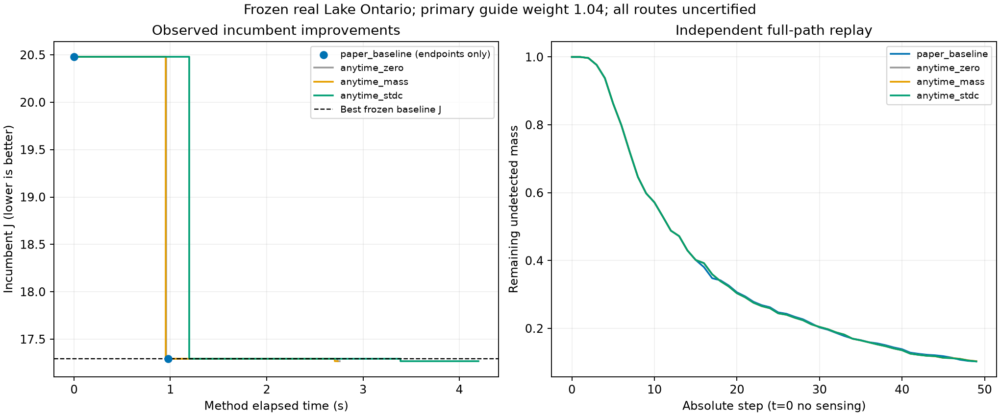
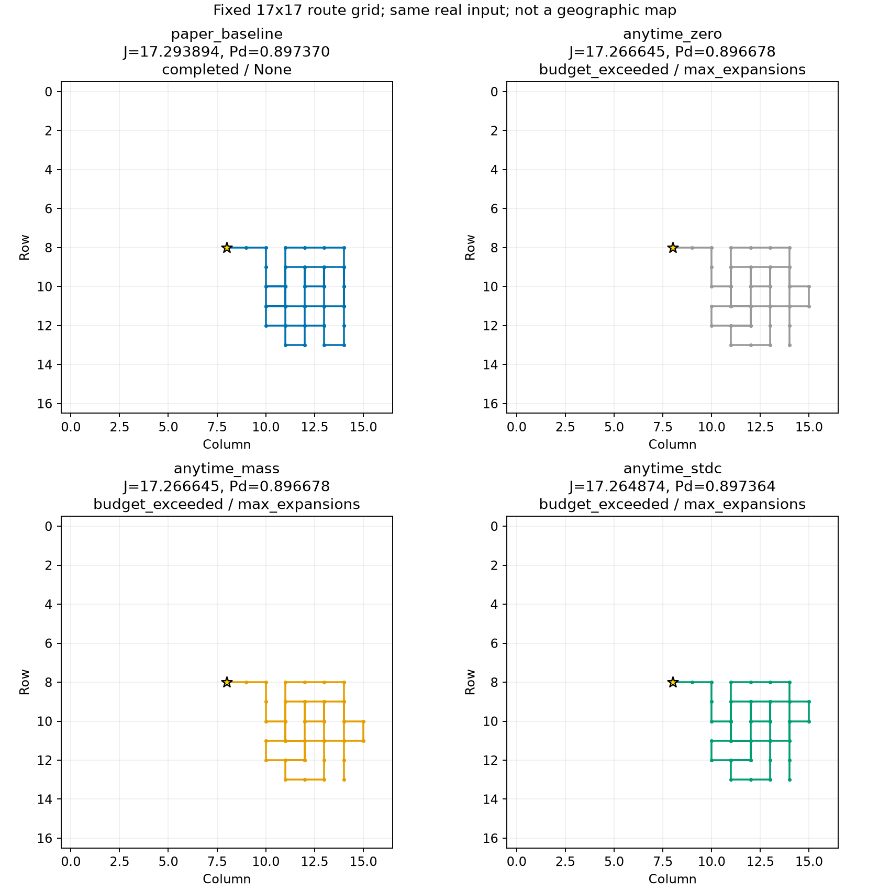
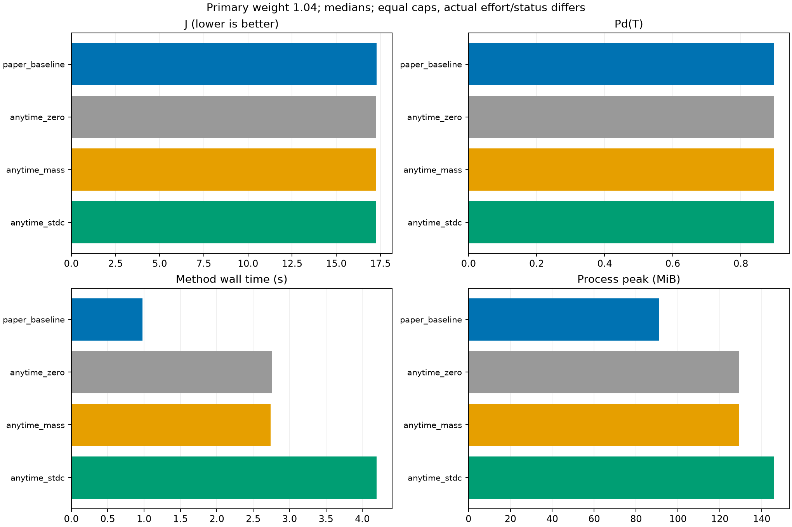

# STDC 全局 anytime：同总预算验证

阶段：smoke；实际运行 6 次。
预先固定最好 baseline J=17.29389415456；STDC 的 3 次运行中 1 次低于它。
这里比较的是每次独立预算内的结果；不同权重的最好值不是免费多次搜索组成的单次方法。
主要预设权重为 1.04；另报 1.1、1.0。权重只控制 paper guide 排序，不是 ε 认证。

每方法上限5000实际展开、20000物理OPEN、30秒。共同输入为已有冻结PT；本次未免费使用最好baseline路径暖启动。
anytime在首解后继续搜索，paper guide只排序；zero/mass/STDC仅用未加权可采纳下界剪枝，所有完整改善用冻结评分器重放。
直接baseline仍按原实现首解停止；相同cap不代表相同实际耗时。新方法额外耗时须与质量收益一起评价。
同一真实Lake Ontario归档、seed41、N500、17×17、T49、q=.78，仍是historical_real_forcing_allwater离散近似。
每worker重新校验forcing/粒子/元数据/UTC/评分器SHA；未运行OpenDrift、改forcing或替换synthetic粒子。
全部完整路线theory_certified=false，预算中止明确记录。正常耗尽frontier也仅按当前数值容差描述，不添加ε声称。

|方法|guide权重|次数|J ↓|Pd ↑|展开|秒|正常/预算中止|
|---|---:|---:|---:|---:|---:|---:|---:|
|paper_baseline|1.04|1|17.293894155|0.897370419|1222|0.9785|1/0|
|anytime_zero|1.04|1|17.266645360|0.896678016|5000|2.7562|0/1|
|anytime_mass|1.04|1|17.266645360|0.896678016|5000|2.7383|0/1|
|anytime_stdc|1.04|1|17.264874448|0.897364416|5000|4.1984|0/1|
|anytime_stdc|1.1|1|17.319001780|0.900067235|5000|3.2493|0/1|
|anytime_stdc|1|1|20.477608336|0.881063040|5000|6.4932|0/1|

## 解释边界

J是唯一原始优化目标，Pd单列；J改善不自动意味着Pd改善。metrics同时报告相对最好J baseline的Pd以及baseline各设置中的最大Pd差值。
anytime_zero/mass/STDC使用相同guide与预算；共同收益属于首解后持续搜索，STDC额外贡献须从控制组差值判断。
三次重复使用同一归档，仅观察时间变化，不是三个独立场景。结果不外推其他事故或forcing；未实现MHA或第二创新点。
未通过的数值/历史回归/真实SHA门槛必须blocked。搜索预算中止与验证失败分开，合法完整incumbent仍完整保存。

命令、stdout/stderr、原始result、逐incumbent独立重放、source_snapshot与源指纹均随各worker归档。
