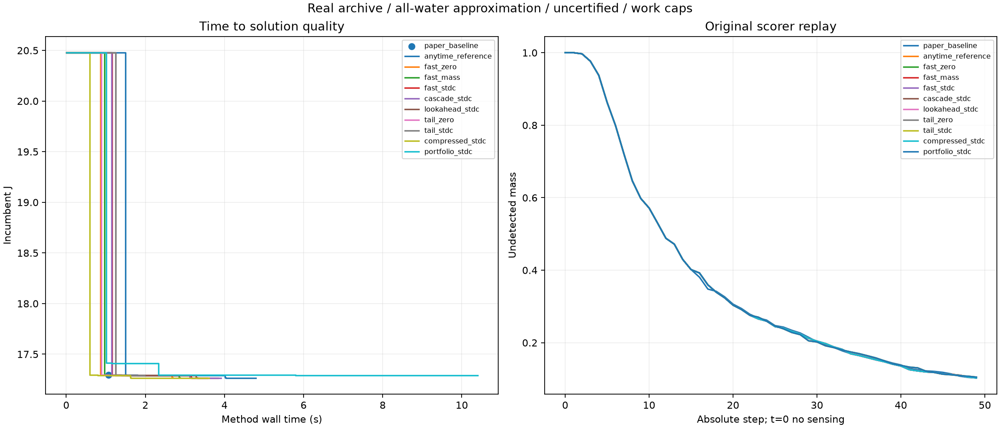
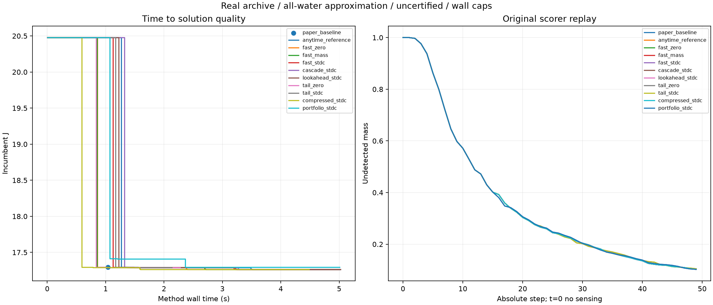
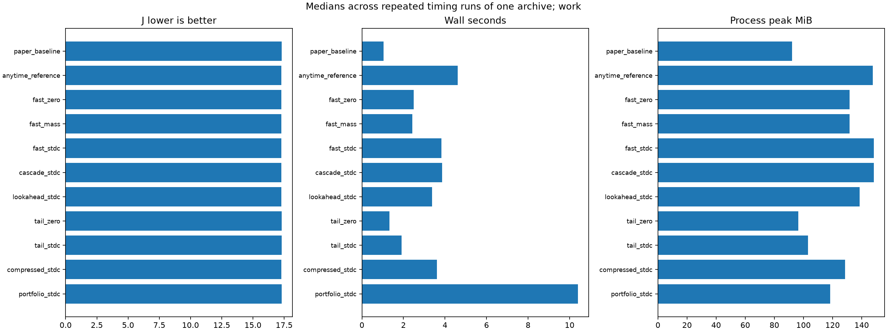
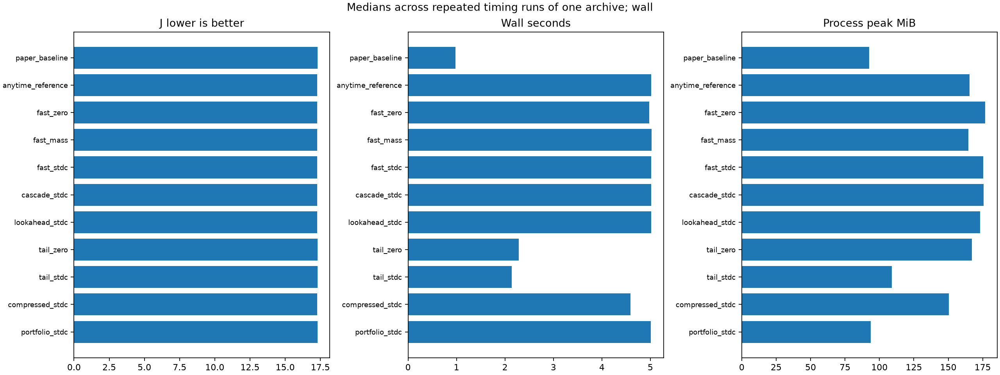

# STDC 优化：继续验证与正式对照报告

**验证状态：passed。所有强制门槛已通过；实验结果仍不构成动态 ε 最优认证。**

日期：2026-11-24（Asia/Shanghai）。研究分支 stdc-research-v0.2。
上轮 blocked 原始目录完整保留。本轮没有更改任何 src/tests/scripts 源码或断言；权限问题通过允许硬链接的执行环境解决。
同一35448账户和解释器在沙箱内对C/E临时目录的硬链接操作均被拒绝，沙箱外成功。完整历史测试在沙箱外原样通过，未修改ACL、跳过测试或替换归档逻辑。

## 质量结论

固定工作量组中，低于前轮STDC的J=17.264874448的方法为：无。
5秒上限组中，低于前轮STDC的J=17.264874448的方法为：无。
这是预定对照中各方法独立付费运行后的描述，不把事后最优方法当成免费组合搜索；具体性能收益与质量取舍见下表和core_comparison.csv。

## 验证结果

|门槛|结果|
|---|---|
|新增单测|199 passed，零失败/错误/跳过|
|全量测试|693 passed＝历史494＋新增199，零失败/错误/跳过|
|随机逐前缀Oracle|160案例、18024前缀；违规0；最大浮点超越8.88e-16，低于1e-10容差|
|两步前瞻增强|1854个前缀严格强于原STDC，仅为这些输入上的数值事实|
|小图搜索|45案例、320次搜索，J与原Oracle误差0，独立重放误差0|
|真实smoke|11/11通过；1正常、10预算中止|
|正式实验|66/66通过；6正常、60预算中止；0认证|
|文件保全|baseline 654文件、研究保护3297文件、源码120文件SHA一致；修改前3199文件不变|

## 指标与成本

J越低越好，Pd越高越好。下面时间和内存是3次重复的中位数；J/Pd范围与逐次配对见CSV。两预算协议分别解释。
core_comparison另报告达到冻结前轮J目标17.264874448的时间（从incumbent历史取首个满足事件），并列达标次数；未达标不填写时间，不把它混为总运行时间。
work：最多5000总工作展开，包含前瞻辅助展开，物理OPEN≤20000，时间≤30秒。
wall：时间上限5秒，无展开上限，物理OPEN≤20000；先触发OPEN可以提前停止。合作式时间检查超额单列。
统一输入为共同冻结PT，guide权重1.04。原baseline首解即停止，相同上限不等于相同实际耗时。
尾段组合付费用40%子配额生成seed，再尝试6/10/14步自由终点尾段；压缩构造、内部重放均计入方法时间。

|协议|方法|J|Pd|秒|主展开|总工作|峰值MiB|停止原因|
|---|---|---:|---:|---:|---:|---:|---:|---|
|work|paper_baseline|17.293894155|0.897370419|1.0469|1222|1222|92.14|{'completed': 3}|
|work|anytime_reference|17.264874448|0.897364416|4.6070|5000|5000|147.57|{'max_expansions': 3}|
|work|fast_zero|17.266645360|0.896678016|2.4944|5000|5000|131.74|{'max_expansions': 3}|
|work|fast_mass|17.266645360|0.896678016|2.4338|5000|5000|131.64|{'max_expansions': 3}|
|work|fast_stdc|17.264874448|0.897364416|3.8240|5000|5000|148.39|{'max_expansions': 3}|
|work|cascade_stdc|17.264874448|0.897364416|3.8658|5000|5000|148.36|{'max_expansions': 3}|
|work|lookahead_stdc|17.264874448|0.897364416|3.3745|4210|5000|138.48|{'max_expansions': 3}|
|work|tail_zero|17.291968495|0.894972397|1.3261|5000|5000|96.49|{'max_expansions': 3}|
|work|tail_stdc|17.291968495|0.894972397|1.9047|2292|2292|103.09|{'global_seed_max_expansions': 3}|
|work|compressed_stdc|17.264874448|0.897364416|3.6030|5000|5000|128.53|{'max_expansions': 3}|
|work|portfolio_stdc|17.291968495|0.894972397|10.3980|2935|2935|118.29|{'max_open': 3}|
|wall|paper_baseline|17.293894155|0.897370419|0.9755|1222|1222|92.44|{'completed': 3}|
|wall|anytime_reference|17.264874448|0.897364416|5.0202|6170|6170|165.44|{'max_seconds': 3}|
|wall|fast_zero|17.264874448|0.897364416|4.9785|43465|43465|176.83|{'max_open': 2, 'max_seconds': 1}|
|wall|fast_mass|17.264874448|0.897364416|5.0239|36511|36511|164.51|{'max_seconds': 3}|
|wall|fast_stdc|17.264874448|0.897364416|5.0154|6669|6669|175.34|{'max_seconds': 3}|
|wall|cascade_stdc|17.264874448|0.897364416|5.0165|6715|6715|175.52|{'max_seconds': 2, 'max_open': 1}|
|wall|lookahead_stdc|17.264874448|0.897364416|5.0185|6368|7573|173.14|{'max_seconds': 3}|
|wall|tail_zero|17.291968495|0.894972397|2.2838|12040|12040|167.25|{'max_open': 3}|
|wall|tail_stdc|17.291968495|0.894972397|2.1366|2689|2689|108.97|{'global_seed_max_seconds': 3}|
|wall|compressed_stdc|17.264874448|0.897364416|4.5893|6887|6887|150.30|{'max_open': 3}|
|wall|portfolio_stdc|17.293894155|0.897370419|5.0055|1369|1369|93.79|{'max_seconds': 3}|

原始最好J baseline参考点为 J=17.29389415456、Pd=0.89737041888；前轮anytime STDC为J=17.264874448、Pd=0.897364416。
Pd差值始终相对同一条最好J基准路径；历史其他权重的最大Pd=0.89776904256，不把两条不同路径的最好指标拼接。

## 归因限制与已知问题

- fast_stdc相对anytime_reference同时改变了guide内核和候选档案/节点簿记，不能把全部时间变化称为纯guide收益；cost_breakdown.csv单列guide和bound成本。
- lookahead的辅助工作计入总预算；更强下界不保证有限预算J更好。cascade和lookahead调用覆盖不同，属于集成策略对照。
- tail_stdc与tail_zero同时改变seed与tail的bound，不能隔离为纯尾段STDC收益。global_seed_*停止原因是子配额中止，未必耗尽全方法总上限。
- tail原始stats大多为尾段局部，seed_stats保存全局seed开销；本报告cost_breakdown已按阶段相加。尾段history.generated仍为局部计数，不当作全局累计量。
- compressed_stdc包含严格分组和readonly无变化共享。分组减少量见compression_analysis.json；浮点求和顺序可能改变排序，最终使用原ID评分器重放。
- portfolio双heap的副本与stale条目全部计物理OPEN，逻辑容量更小；max_open必须明确报告。
- search_wall_s是方法调用时间（含内部重放/压缩构造），不是含外部核验与进程启动的端到端耗时。进程峰值包括导入和输入核验。
- preflight的seed_subbudget=null为不完整描述，tail实际40%配额以benchmark/protocol.json与raw phases为准。
- 全部是一个真实历史forcing的all-water离散归档，N500、17×17、T49、q=.78、seed41；三重复不是三个独立场景。不外推其他事故或真实海岸约束。
- 保持t=0不检测、四连通、未归一化未探测权重与所有特殊质量；J仍是唯一优化目标，未添加Pd约束。
- paper_greedy只排序；预算中止的路径没有动态ε保证。完整小图Oracle一致性不能替代一般数学证明。

## 交付

- core_comparison.csv/json：核心J/Pd、相对原baseline及前轮STDC差值、同协议配对差值。
- cost_breakdown.csv、compression_analysis.json：各方法成本和分组记录。
- benchmark/metrics.csv、aggregate.csv、paired_comparisons.csv：原始汇总及3次范围。
- benchmark/results.json及各worker/raw_result.json：完整路径、incumbent、预算来源、SHA与独立重放。
- final_preservation.json、artifact_manifest.json：输入、源码、旧结果保全与本轮产物指纹。
- validation各阶段和每个worker的command.json、stdout/stderr、pytest.xml/stage.json、diff和seed均保留。
- 新增代码文件清单见上一轮changed_files.json；本轮源码变化为0。

路径图为benchmark/work_paths.png与wall_paths.png。

## 离线复跑

解释器C:/Users/35448/.conda/envs/maritime-sar/python.exe；保持scripts/offline_guard、src、scripts在PYTHONPATH，数值库单线程，ASAR_OFFLINE=1、PROJ_NETWORK=OFF、PYTHONDONTWRITEBYTECODE=1。
使用全新结果目录，依次执行run_optimization_validation.py的init/new_tests/full_tests/random_audit/small_search；完整命令和环境见各command.json。
历史测试需要允许Windows硬链接的执行上下文。随后执行run_optimization_experiments.py smoke及benchmark，提供通过的validation_summary.json和smoke目录；最后final_preservation。
禁止覆盖既有输出；没有运行OpenDrift重新生成轨迹、改forcing或开展第二创新点。
