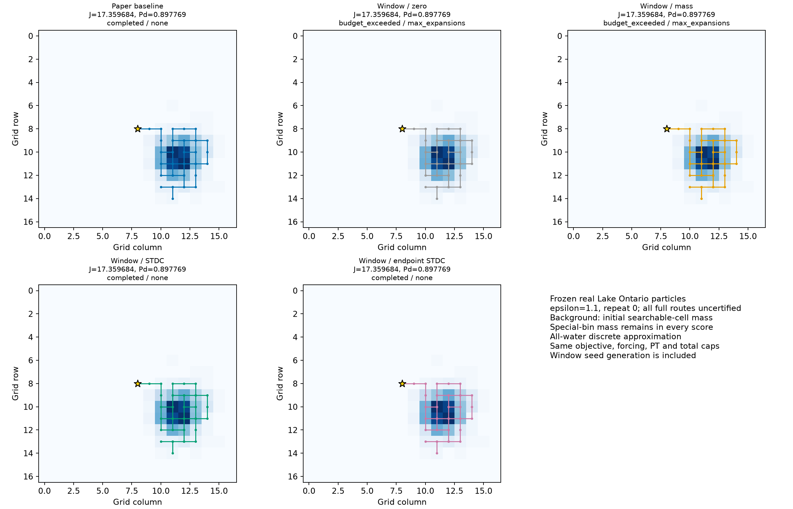
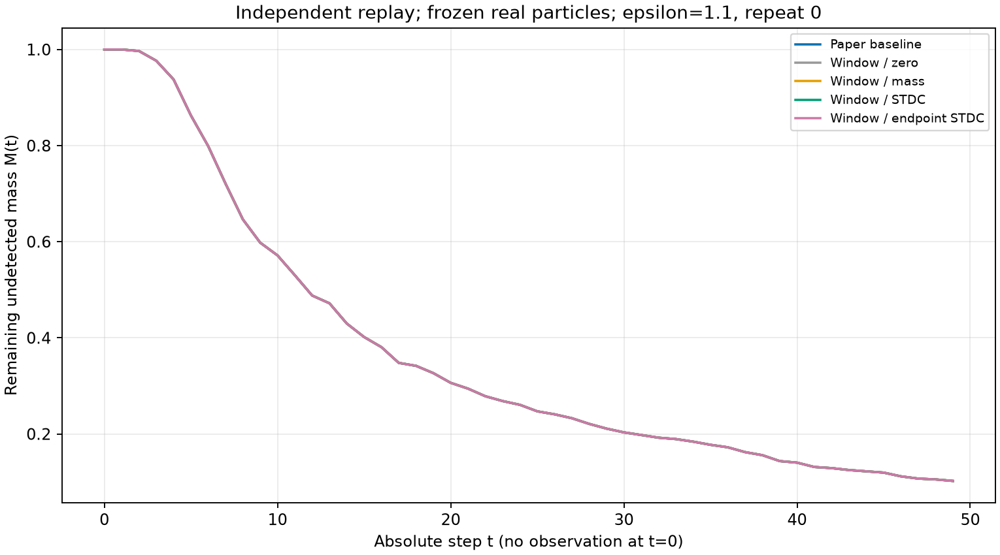
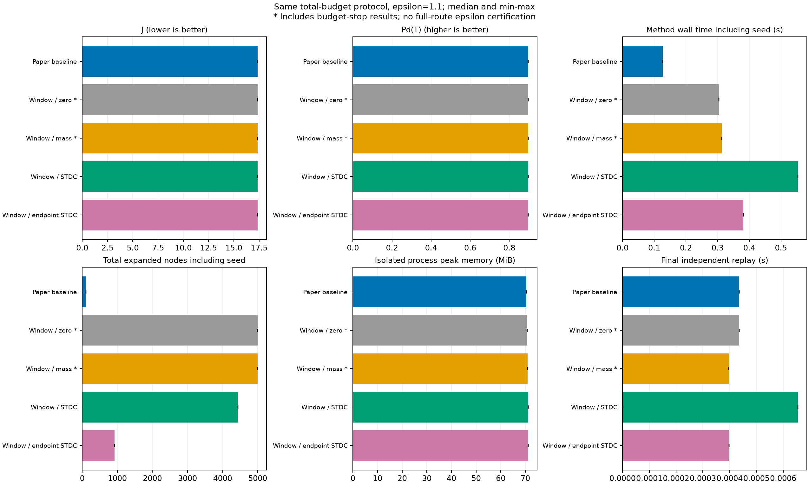

# 固定后缀窗口搜索：J/Pd 同预算验证

实验阶段：`smoke`；计划/实际运行：6/6。
本报告是新研究协议的本地数值结果；原 B7 配置、归档、评价器和历史结果保持只读。

endpoint STDC 相对 paper baseline：1 组配对中，J 改善 0 组，Pd 改善 0 组。
在本次配对实验中没有验证到 endpoint STDC 的 J 改善；不能宣称核心目标获得提升。
J 是唯一优化目标；Pd 独立报告。J 降低不自动意味着终点 Pd 上升；表中保留可能的取舍。
Smoke 仅为运行与评分检查；三次重复使用同一冻结输入，主要用于观察时间变化，不是三个独立场景。

## 同数据、同总预算与计时

每方法总 cap：expanded=5000，OPEN=20000，wall=30 s。
paper baseline 直接使用全部 cap。四个窗口控制方法均先支付 paper seed（最多 1500 次展开），再使用剩余共享预算，窗口长度为 [4, 6]。
冻结 PT 是各方法共用的已有输入；本实验不重新生成历史 PT。计入预算的种子成本指 paper A^SAR 搜索及其内部处理。
ε 控制 paper A^SAR 种子/直接基线；局部窗口按未加权下界排序并在预算内求改进，不将 ε 解释为完整路线保证。
seed 的展开子配额用完允许继续局部搜索；全局时间或 OPEN 中止则不能继续。所有 seed/window 节点计数逐项核对。
方法时间从调用前到返回后外部测量，包含种子生成、内部评分和局部搜索；最终独立全路径重放另列。SHA 预检与进程启动另列。时间上限为合作式检查，超额时间如实记录。
每条运行在新进程中执行，线程设为 1；峰值内存包含导入、预检、算法和重放。stdout/stderr、命令与退出码逐运行保存。

## 输入与保证范围

输入标记：`historical_real`；粒子 SHA-256：`8b30a87e543f1b33c39e70e1d0054e1750ec046ba2e0b627dd311d9945749456`。
冻结输入协议 SHA-256：`bc18ddcb922231168aef34d8805bd3f7388a2b3ed9c27e9522368141fa469ff7`。每次 worker 重查 forcing、粒子、元数据、UTC 与评价器 SHA。
使用已有 B3 真实历史粒子归档；未调用漂移模型重生成，未用合成粒子替换。场景仍采用冻结的 all-water 离散近似。
paper_greedy 在动态场景无可采纳保证。全部完整路线 `theory_certified=false`。局部下界仅对应固定终点、固定时刻、固定后缀及相应模型假设；局部搜索正常结束不等于全路径 ε 最优。
所有预算中止保留可行 incumbent、来源和 stop_reason。`completed` 表示该方法协议正常返回，不能解释为全局最优。

## 核心指标（中位数；范围保存在 aggregate.csv）

|方法|ε|次数|J ↓|Pd ↑|方法秒数|展开总数|正常/预算中止|
|---|---:|---:|---:|---:|---:|---:|---:|
|window_stdc_endpoint_lb|1|1|18.331441506|0.890512659|2.4186|4952|1/0|
|paper_baseline|1.1|1|17.359684022|0.897769043|0.1270|107|1/0|
|window_zero|1.1|1|17.359684022|0.897769043|0.3044|5000|0/1|
|window_mass_lb|1.1|1|17.359684022|0.897769043|0.3130|5000|0/1|
|window_stdc_lb|1.1|1|17.359684022|0.897769043|0.5538|4437|1/0|
|window_stdc_endpoint_lb|1.1|1|17.359684022|0.897769043|0.3814|920|1/0|

## 收益归因限制

`window_zero`、`window_mass_lb`、`window_stdc_lb` 与 `window_stdc_endpoint_lb` 使用相同窗口调度、初始 PT 和 seed 子预算。与 paper baseline 的差值反映整个窗口方法；endpoint 与其余窗口控制的差值更接近下界设计的贡献。不能将所有窗口改进归功于 STDC。

|对照|J 改善/配对数|J 变差|Pd 改善|Pd 变差|
|---|---:|---:|---:|---:|
|endpoint STDC vs paper_baseline|0/1|0|0|0|
|endpoint STDC vs window_zero|0/1|0|0|0|
|endpoint STDC vs window_mass_lb|0/1|0|0|0|
|endpoint STDC vs window_stdc_lb|0/1|0|0|0|

## 图与审计文件

- `metrics.csv` / `results.json`：全部运行及完整轨迹、状态、来源。
- `paired_comparisons.csv`：逐 ε、逐重复配对 J/Pd 和控制组差值。
- `plan.json` / `input_gate.json`：新协议和真实输入 SHA。
- `source_manifest.json` / `source_snapshot/` / `git_diff.patch`：源码和工作树证据。
- `validation_evidence.json`：新测、历史测试及 toy Oracle 前置门槛证据。
- 各 worker 目录：command、stdout、stderr、raw_result、独立 replay 与计数核对。
